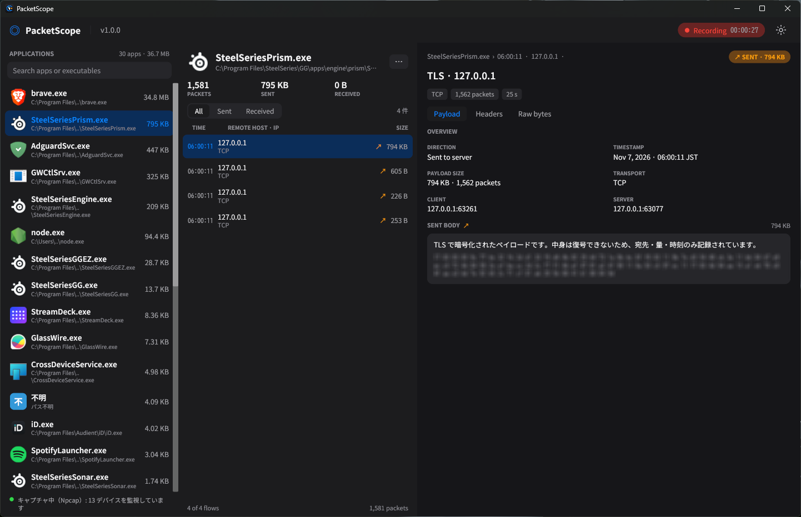

<p align="center">
  
</p>

# PacketScope

**「どのアプリが、いつ、どこへ、どれだけ、何を送受信したか」をアプリ単位で見るためのパケットキャプチャツールです。**

Rust 製 Windows 用アプリケーションです。
パケットキャプチャ専用に設計しており、プロキシ設定や証明書ストアは一切変更しません。

## 🚀 主な機能

- **アプリ単位のパケットキャプチャ** — NIC を通る通信をプロトコルを問わず取得し、OS の接続表と突き合わせてアプリごとに記録します（Windows: IP Helper API / macOS: `lsof` / Linux: `/proc`）
- **3カラム UI**
  - 左カラム: 通信したアプリの一覧（アプリアイコン・アプリ名・実行ファイルのパス・総通信量の大きい順）。検索つき
  - 中カラム: 選択したアプリのキャプチャ履歴。PACKETS / SENT / RECEIVED の集計と、All / Sent / Received フィルタ
  - 右カラム: 選択したフローの詳細。概要、Payload、Headers、Raw bytes（16進ダンプ）のタブ表示
- **平文プロトコルは中身まで表示** — HTTP の本文やヘッダー、DNS の名前解決などをそのまま確認できます
- **暗号化通信はメタデータを表示** — TLS / QUIC は復号できませんが、接続先ホスト名（SNI）、TLS バージョン、通信量、時刻が分かります
- **ダーク / ライトテーマ** — 右上のボタンで切り替え、設定は保存されます
- **ダブルクリックで管理者として起動** — exe に `requireAdministrator` マニフェストを埋め込み済みのため、右クリックメニューは不要です。インストーラが作成するショートカットにも管理者実行フラグが付いています
- **待ち受けポートなし・外部への送信なし** — PacketScope 本体はネットワークへ接続しません（唯一の例外は、インストーラが Npcap 公式インストーラを取得する1件のみで、実行前に Authenticode 署名を検証します）

## ⚙️ システム要件

- **OS**: Windows 10 / 11（64ビット）— リリースパッケージの対象です。macOS / Linux ではソースからビルドできます
- **Npcap**: パケットキャプチャに必要です。未導入の場合はインストーラが公式サイトから取得して起動します。Npcap が無い環境では接続表モード（接続先のみ、中身とバイト数は制限）で動作します
- **管理者権限**: キャプチャのため必要です。起動時に UAC の確認が表示されます

## 🛠️ インストール手順

### リリースパッケージの exe ファイルを実行する方法

1. 本リポジトリの [Releases](../../releases) から `packetscope-v1.0.0.zip` をダウンロードし、展開します
2. `packetscope-setup.exe` を実行します（UAC の確認で許可してください）
   - 本体が `C:\Program Files\PacketScope` に配置されます
   - スタートメニューとデスクトップにショートカットが作成されます
   - 「アプリと機能」にアンインストール用エントリが登録されます
3. Npcap が無い場合は、公式インストーラ（npcap.com）のダウンロードと署名検証のあとインストーラが起動するので、画面の指示に従ってインストールしてください
4. スタートメニューまたはデスクトップの「PacketScope」から起動します

単体の `packetscope.exe` でも動作します（管理者として起動します）。

アンインストールは「アプリと機能」から、または設置フォルダの `uninstall.exe` から行えます。

## 📦 ビルド手順

### ソースコードをビルドして使う場合

前提:

- Rust ツールチェーン（stable）
- Windows の場合: [Npcap SDK](https://npcap.com/#download)、環境変数 `LIBPCAP_LIBDIR` に SDK の `Lib\x64` フォルダを指定
- アイコンと管理者マニフェストの埋め込みにはリソースコンパイラを使います（llvm-rc、または Windows SDK の rc.exe。無い場合の挙動は `build.rs` のコメント参照）

本体のビルド（Windows / PowerShell）:

```powershell
git clone git@github.com:k4zuki02h4t4/PacketScope.git
cd PacketScope
$env:LIBPCAP_LIBDIR = "C:\path\to\npcap-sdk\Lib\x64"
cargo build --release
# -> target\release\packetscope.exe
```

インストーラ（`packetscope-setup.exe`）もビルドする場合、本体 exe を内蔵する作りのため、先に本体を `installer-assets` へ配置してからビルドします:

```powershell
New-Item -ItemType Directory -Force installer-assets
Copy-Item target\release\packetscope.exe installer-assets\
cargo build --release --bin packetscope-setup
```

macOS / Linux では libpcap（macOS は標準搭載、Linux は `libpcap-dev` 等）を用意し、`cargo build --release` のあと管理者権限で実行してください（root で実行するか、macOS では BPF デバイスへのアクセス許可、Linux では `CAP_NET_RAW` が必要です）。

## 📖 使用方法

起動すると自動的にキャプチャが始まり、キャプチャ状態が画面下部に表示されます。

- **左カラム**でアプリを選ぶと、そのアプリの通信履歴が中カラムに表示されます。上部の検索欄でアプリ名や実行ファイル名で絞り込めます
- **中カラム**の All / Sent / Received で送受信を切り替えられます。行を選ぶと右カラムに詳細が出ます
- **右カラム**では Payload（本文）、Headers（HTTP ヘッダー）、Raw bytes（16進ダンプ）のタブを切り替えられます
- 中カラム右上の「…」ボタンから **ファイルの場所を開く** と、選択中アプリの実行ファイルをエクスプローラーで開けます
- **テーマ切り替え**は右上のボタンです

### 除外指定

監視対象から外したいアプリは、設定ファイル `%LOCALAPPDATA%\PacketScope\settings.txt`（macOS / Linux は data_dir 配下）に `exclude=アプリ名` の行を1行1件で書いてください（設定画面はありません）。

### 注意・制限

- TLS / QUIC など暗号化された通信の**中身は復号できません**。分かるのは接続先（SNI ホスト名）、TLS バージョン、通信量、時刻です
- 通信内容の表示はフローの先頭ペイロードが対象です（ストリーム再構成はしていません。本文プレビュー最大 4,096 文字、生バイトは先頭 2,048 バイト、Raw 表示は先頭 512 バイト）
- アプリ名の特定は OS の接続表との突き合わせのため、短命な接続や一部プロトコルでは特定できないことがあります
- 時刻表示は JST 固定です

## 📋 ライセンス

MIT License

このプロジェクトは [MIT License](LICENSE) のもとで公開されています。
